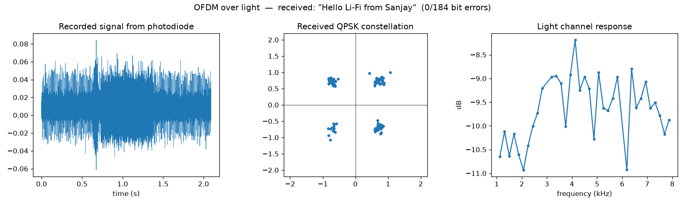
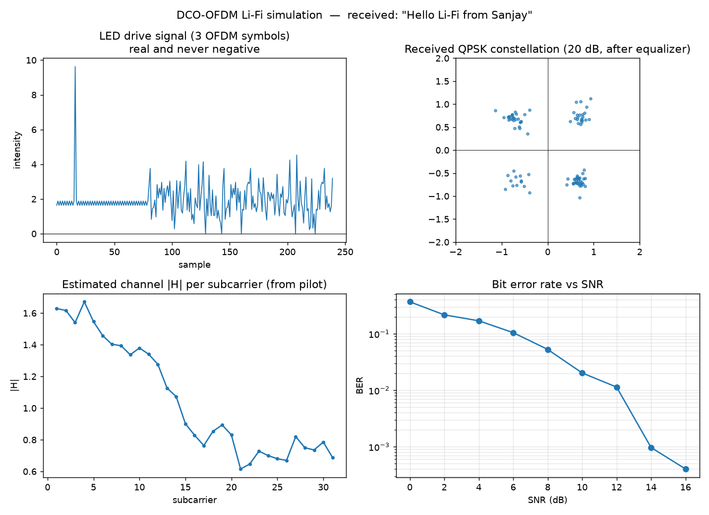
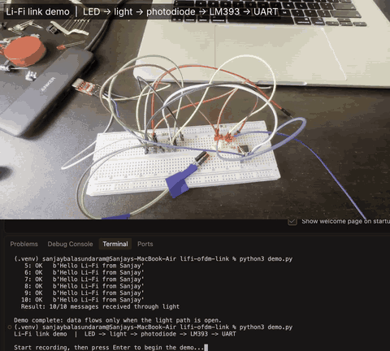
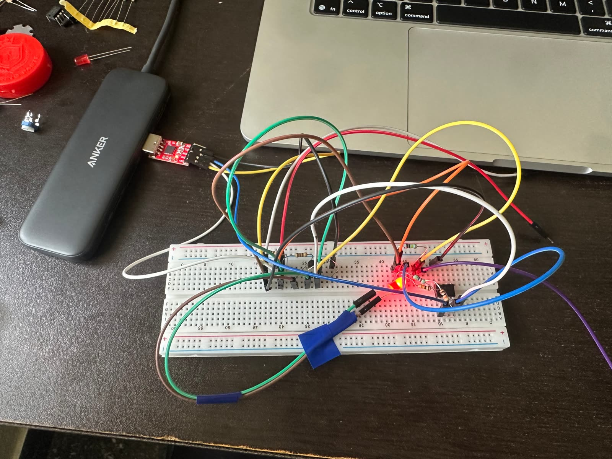

# Li-Fi Communication Link with OFDM (Visible Light Communication)

A working data link that sends text from a laptop **through light**, built in stages:

- **Phase 1:** UART on-off keying through an LED and photodiode, error-free up to 115.2 kbps.
- **Phase 2:** **OFDM over light**: 35 QPSK subcarriers generated in Python, sent through a white LED, received by a photodiode, and decoded back to text. **10/10 packets error-free** on real hardware.

Coming next: a live dashboard and PCB (Phase 3), and the OFDM baseband in Verilog on an FPGA (Phase 4, the VLSI part).

---

## Phase 2: OFDM over light



Real hardware result: the text `Hello Li-Fi from Sanjay` was sent as an OFDM signal through a white LED and received by a BPW34 photodiode. The constellation shows four clean QPSK clusters. Full log of the 10-packet test: [`results/ofdm_light_10runs_2026-11-15.txt`](results/ofdm_light_10runs_2026-11-15.txt)

### Signal chain

```
Python OFDM TX ─► Mac headphone jack ─► BC547 LED driver ─► white LED ~~~light~~~► BPW34 ─► LM358 buffer ─► USB sound card ─► Python OFDM RX
```

### OFDM design

| Parameter | Value |
|---|---|
| Sample rate | 48 kHz (audio interfaces) |
| FFT size / cyclic prefix | 256 / 64 samples |
| Subcarrier spacing | 187.5 Hz |
| Data subcarriers | 35 (1.1–7.9 kHz), QPSK |
| Real-valued signal | Hermitian symmetry (an LED can only send intensity) |
| Sync | 1–8 kHz chirp + cross-correlation |
| Channel estimate | Known QPSK pilot symbol per packet copy |
| Robustness | Packet sent 24×, copies re-timed and averaged |

### Problems found on real hardware, and how they were solved

1. **Electrical noise from the USB sound card.** The noise was the same with the light blocked, so it was electrical rather than optical. Fix: send the packet 24 times and average the equalized copies. A single copy had 2–28 bit errors; the averaged result had 0.
2. **Interference at 3 kHz and 6 kHz.** Per-subcarrier SNR analysis of a real recording showed 3 kHz at −2 dB while most subcarriers were near 20 dB. Both frequencies are multiples of 1 kHz, the USB 1 ms frame rate. Fix: null those two subcarriers, as Wi-Fi and LTE do around interference.
3. **Two clocks that don't agree.** The Mac's headphone output and the USB card run on separate clocks, and macOS adjusts the timing mid-recording: in one failed packet the signal drifted 19 samples, then reversed. Fix: locate every copy's pilot separately, interpolate the timing of each symbol, remove the leftover fraction of a sample as a phase ramp, and weight copies by pilot quality. The receiver tries this and a steady-drift method on every packet and keeps the cleaner result.

### Results (real hardware, 15 Nov 2026)

| Test | Result |
|---|---|
| Packets received with 0 bit errors | **10 / 10** |
| Signal quality after averaging | 16–19 dB |
| Bit errors in one copy alone | 2–28 of 184 |
| Raw OFDM rate | 10.5 kbps (35 × 2 bits × 150 symbols/s) |
| Effective payload rate with 24× averaging | ≈ 0.3 kbps |

The low effective rate comes from the 24× repetition. The next step is forward error correction, which needs far less repetition.

### Phase 2 circuit

- **Transmitter:** headphone signal → 10 µF → BC547 base, biased by 47 kΩ (to 5 V) and 22 kΩ (to GND). 220 Ω emitter resistor, white 5 mm LED in the collector. Measured emitter voltage 0.75 V, so about 3.5 mA bias current. A music test made the LED visibly pulse with the bass.
- **Receiver:** BPW34 signal node (100 kΩ load) → 10 µF → LM358 non-inverting input, biased to mid-supply by 2 × 47 kΩ (measured 2.68 V). The LM358 is wired as a unity-gain buffer, then → 10 µF → USB sound card mic input.
- The 3.5 mm sockets have two wires soldered on (tip and ground, found with a continuity test).

### Simulation first



[`ofdm_sim.py`](ofdm_sim.py) simulates the full DCO-OFDM link (64-point FFT, 31 subcarriers, multipath channel, noise) before any hardware. The BER drops to zero above 18 dB SNR.

---

## Phase 1: UART link through light



Phone camera (top) synced with the terminal (bottom) running `demo.py`: **10/10** messages with the light on, **0/10** while a sheet of paper blocks the light, and **10/10** again once it is removed. The idle 20-second countdowns are cut out, and the phone recording ends a few seconds before the final test finishes (the terminal shows the result). [Full-quality video](media/lifi_demo.mp4)



```
Mac ──USB──► CP2102 TXD ──► BC547 switch ──► Red LED  ~~~light~~~►  BPW34 photodiode ──► LM393 comparator ──► CP2102 RXD ──USB──► Mac
```

- **Transmitter:** UART TXD drives a BC547 transistor (via a 1 kΩ base resistor), which switches the LED (2 × 100 Ω current limit) from 5 V. Each UART bit becomes an on/off flash of light (on-off keying).
- **Receiver:** the BPW34 photodiode (reverse-biased, 100 kΩ load) converts light to a voltage. An LM393 comparator compares it with a 2.5 V reference (two 10 kΩ resistors) and outputs a clean 0/5 V logic signal (4.7 kΩ pull-up) into UART RXD.
- **Why the comparator was needed:** connecting the photodiode directly to RXD failed. The CP2102's internal pull-up held the line at about 2.5 V even in darkness, so RXD never saw a logic 0.

20 messages of 23 bytes per baud rate. Full log: [`results/speed_test_2026-11-14.txt`](results/speed_test_2026-11-14.txt)

| Baud rate | Light path open | Light path blocked (control) |
|---|---|---|
| 1200 – 115200 (8 rates) | 20/20 at every rate | 0/20 at every rate |

---

## Components

| Part | Used for |
|---|---|
| CP2102 USB-to-TTL | Phase 1 UART, and 5 V supply |
| BC547 NPN × 2 | LED drivers (Phase 1 switch, Phase 2 linear) |
| Red LED, white 5 mm LED | Optical transmitters |
| BPW34 PIN photodiode | Optical receiver |
| LM393 comparator | Phase 1 slicer |
| LM358 op-amp | Phase 2 buffer |
| USB sound card (mic in) | Phase 2 receiver ADC |
| 3.5 mm sockets × 2, AUX cables × 2 | Audio connections |
| Resistors, 10 µF capacitors | Bias, coupling |

## Running it

```bash
python3 -m venv .venv
source .venv/bin/activate
pip install -r requirements.txt

# Phase 1 (UART through light)
python3 lifi_test.py            # 10 messages at 1200 baud
python3 speed_test.py           # 1200–115200 baud
python3 demo.py                 # guided light-on / blocked / light-on demo

# Phase 2 (OFDM)
python3 ofdm_sim.py             # simulation, saves results/ofdm_sim.png
python3 ofdm_light.py           # send one OFDM packet through light
python3 ofdm_light.py --runs 10 # reliability test
python3 ofdm_light.py --selftest  # software-only check, no hardware
```

For Phase 2, set **Sound → Output** to *External Headphones* and **Input** to the USB sound card, and turn the Mac volume to maximum.

## Roadmap

- [x] Phase 1: UART/OOK link through light, verified up to 115.2 kbps
- [x] Phase 2: OFDM over light, 10/10 packets error-free on real hardware
- [ ] Forward error correction, to replace most of the 24× repetition
- [ ] Phase 3: live dashboard (constellation, BER) and KiCad PCB
- [ ] Phase 4: OFDM baseband core in Verilog on an FPGA

## Author

Sanjay Balasundaram, B.E. Electronics and Communication Engineering
